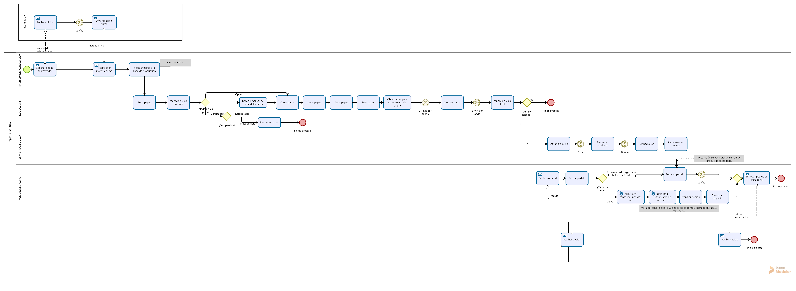

# BPMN TO-BE Final y Automatización en n8n

> **Responsable:** [Nombre integrante encargado de BPMN / n8n]  
> **Corresponde a:** Sección 4 del Informe E2

---

## 1. Diagrama BPMN TO-BE Final
*(Subir imagen legible a `entrega-2/assets/bpmn-tobe-final.png`)*

* **Explicación del flujo:** El proceso comienza con la recepción y revisión del pedido. Luego se identifica el canal de venta. Para los pedidos web, el sistema registra y consolida los pedidos y notifica al responsable para que inicie la preparación. Después se gestiona el despacho y se entrega el pedido al transporte. Los pedidos de supermercados y distribuidores regionales siguen una ruta común de preparación y despacho. En el canal web, la meta es que transcurran como máximo dos días desde la compra hasta la entrega al transporte.

---

## 2. Cambios respecto al BPMN de la Entrega 1
En el BPMN de la Entrega 1, la preparación del pedido aparecía antes de identificar el canal de venta. En la versión final, la decisión se trasladó inmediatamente después de la revisión del pedido. Esto permitió ubicar el registro, la consolidación y la notificación de los pedidos web antes de la preparación, de modo que el aviso indique al responsable cuándo iniciar su trabajo. Los canales de supermercado y distribuidor regionales se agruparon porque compartían el mismo plazo y destino de despacho. Además, el temporizador de dos días del canal digital se reemplazó por una anotación que explicita la meta y el tramo en que se mide. 

---

## 3. Automatización con n8n
*(Subir captura a `entrega-2/assets/flujo-n8n.png` y archivo exportado en `entrega-2/n8n/`)*

* **Disparador y nodos:** *(Explicar paso a paso: Trigger → Consulta SQL → Condición >24h / >48h → Notificación).*

---

## 4. Trazabilidad: Tareas BPMN ↔ Nodos n8n ↔ Tablas MySQL

| Tarea BPMN *to-be* | Nodo / Acción en n8n | Tabla(s) en MySQL (`ruta`) |
| :--- | :--- | :--- |
| **Registro automático del pedido** | *(Completar nodo)* | `cliente`, `pedido`, `detalle_pedido` |
| **Detección y alerta de retraso (>24h)** | *(Completar nodo)* | `pedido`, `cliente` |
| **Gestionar preparación y despacho** | *(Completar nodo)* | `pedido`, `despacho` |
