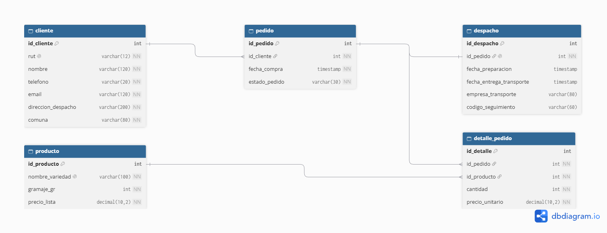

# Modelo de Datos en 3FN y Diccionario de Datos — Ruta Snack SpA

## 1. Diagrama Entidad-Relación (3FN)

---

## 2. Proceso de Normalización Aplicado (1FN → 2FN → 3FN)

El esquema relacional de **Ruta Snack SpA** se construyó cumpliendo en orden las tres primeras formas normales. Con esto se busca que cada atributo dependa *"de la clave, de toda la clave y de nada más que de la clave"*.

### Primera Forma Normal (1FN: atomicidad y eliminación de grupos repetitivos)
* **Regla aplicada:** Cada atributo guarda un solo valor, indivisible. No hay columnas numeradas (`sabor1`, `sabor2`...) ni listas separadas por comas dentro de una misma celda.
* **Evidencia en el modelo:** En vez de almacenar listas de sabores o cantidades dentro de `pedido`, los productos comprados pasaron a una entidad propia, `detalle_pedido`, donde cada fila corresponde a un único producto dentro de un pedido. Además, la dirección del cliente se dividió en atributos atómicos (`direccion_despacho` y `comuna`) y el formato del producto se aisló en el atributo `gramaje_gr`.

### Segunda Forma Normal (2FN: eliminación de dependencias parciales y resolución de relaciones N:M)
* **Regla aplicada:** Todo atributo que no sea clave debe depender de la clave primaria o candidata completa, no solo de una parte de ella.
* **Evidencia en el modelo:** La relación muchos a muchos ($N:M$) entre `pedido` y `producto` (un pedido incluye varios sabores y un mismo sabor se vende en muchos pedidos) se resolvió dividiéndola en dos relaciones $1:N$. Para ello se usó la entidad asociativa `detalle_pedido`, con una restricción única sobre `(id_pedido, id_producto)`. Los atributos propios del catálogo (`nombre_variedad`, `gramaje_gr` y `precio_lista`) dependen solo de `id_producto` y no del pedido, así que quedan en `producto` (eliminando `stock_disponible` del modelo preliminar al quedar fuera del alcance en la Entrega 1). En `detalle_pedido` permanecen únicamente `cantidad` y `precio_unitario`, este último como el precio "congelado" al día de la venta.

### Tercera Forma Normal (3FN: eliminación de dependencias transitivas y datos derivados)
* **Regla aplicada:** Ningún atributo que no sea clave debe depender, de forma transitiva, de otro atributo que tampoco sea clave.
* **Evidencia en el modelo:**
  * Los datos personales y de ubicación del cliente (`rut`, `nombre`, `telefono`, `email`, `direccion_despacho` y `comuna`) dependen de `id_cliente` y no de `id_pedido`. Al trasladarlos a `cliente` se elimina la dependencia transitiva `id_pedido` $\rightarrow$ `id_cliente` $\rightarrow$ `direccion_despacho`. Asimismo, respecto al modelo preliminar, se eliminó `region` de `cliente` debido a que la comuna determina funcionalmente a la región (`comuna` $\rightarrow$ `region`, dependencia transitiva).
  * Respecto al modelo preliminar de la Entrega 1, se quitó el atributo `monto_total` de `pedido`, ya que es un dato derivado que puede calcularse dinámicamente con consultas SQL a partir de `detalle_pedido`.
  * El seguimiento logístico se separó en `despacho`, que se relaciona $1:1$ con `pedido` mediante una FK única (`id_pedido`). Así quedan aislados los hitos de tiempo (`fecha_preparacion` y `fecha_entrega_transporte`) y los datos del operador logístico (`empresa_transporte` y `codigo_seguimiento`).

---

## 3. Anomalías Evitadas gracias a la 3FN

Si la empresa siguiera trabajando con una sola planilla sin normalizar ("todo en uno"), tendría tres anomalías graves que este modelo elimina:

* **Anomalía de inserción:** Con el diseño en 3FN se puede registrar un cliente nuevo en `cliente`, o una nueva variedad de papas fritas en `producto`, sin que exista un pedido previo asociado.
* **Anomalía de actualización:** Si un cliente frecuente cambia su dirección o su teléfono, basta modificar una sola fila en `cliente`, y el cambio se aplica automáticamente a todos sus pedidos futuros, sin repetir trabajo ni generar inconsistencias. Del mismo modo, si Ruta cambia el `precio_lista` de sus papas en `producto`, los pedidos históricos mantienen intacto el `precio_unitario` que se cobró en `detalle_pedido`.
* **Anomalía de eliminación:** Si se anula o elimina un pedido en `pedido` (con eliminación en cascada de sus filas en `detalle_pedido` y `despacho`), no se pierde el registro del cliente ni la información del catálogo de productos.

---

## 4. Diccionario de Datos Consolidado (MySQL 8)

| Entidad | Claves (PK / FK) | Atributos y Tipos | Reglas de Integridad y Negocio |
| :--- | :--- | :--- | :--- |
| **cliente** | **PK:** `id_cliente` (`INT AUTO_INCREMENT`) | `rut` (`VARCHAR(12)`), `nombre` (`VARCHAR(120)`), `telefono` (`VARCHAR(20)`), `email` (`VARCHAR(120)`), `direccion_despacho` (`VARCHAR(200)`), `comuna` (`VARCHAR(80)`) | `rut` es `UNIQUE` y `NOT NULL` (evita duplicados); sin `region` para evitar dependencia transitiva con `comuna`[cite: 24]; todos los campos son `NOT NULL` para asegurar datos mínimos de despacho. |
| **producto** | **PK:** `id_producto` (`INT AUTO_INCREMENT`) | `nombre_variedad` (`VARCHAR(100)`), `gramaje_gr` (`INT`), `precio_lista` (`DECIMAL(10,2)`) | `nombre_variedad` es `UNIQUE` y `NOT NULL`; `CHECK`: `gramaje_gr > 0` y `precio_lista >= 0`; `precio_lista` guarda el precio vigente hoy. |
| **pedido** | **PK:** `id_pedido` (`INT AUTO_INCREMENT`), **FK:** `id_cliente` (`INT`) $\rightarrow$ `cliente` | `fecha_compra` (`TIMESTAMP`), `estado_pedido` (`VARCHAR(30)`) | `fecha_compra` asigna `CURRENT_TIMESTAMP` por defecto; `CHECK` en `estado_pedido` (`'Pendiente'`, `'En preparacion'`, `'Despachado'`); sin `monto_total` (3FN); `ON DELETE RESTRICT` en cliente. |
| **detalle_pedido** | **PK:** `id_detalle` (`INT AUTO_INCREMENT`), **FK1:** `id_pedido` (`INT`) $\rightarrow$ `pedido`, **FK2:** `id_producto` (`INT`) $\rightarrow$ `producto` | `cantidad` (`INT`), `precio_unitario` (`DECIMAL(10,2)`) | `UNIQUE (id_pedido, id_producto)` evita repetir el mismo sabor en un pedido; `CHECK`: `cantidad > 0` y `precio_unitario >= 0`; `precio_unitario` congela el precio histórico de venta. |
| **despacho** | **PK:** `id_despacho` (`INT AUTO_INCREMENT`), **FK:** `id_pedido` (`INT`) $\rightarrow$ `pedido` | `fecha_preparacion` (`TIMESTAMP`), `fecha_entrega_transporte` (`TIMESTAMP`), `empresa_transporte` (`VARCHAR(80)`), `codigo_seguimiento` (`VARCHAR(60)`) | `id_pedido` es `UNIQUE` y `NOT NULL` (relación estricta 1:1); campos admiten `NULL` mientras el pedido está en estado `'Pendiente'`; `CHECK`: `fecha_entrega_transporte >= fecha_preparacion`. |
