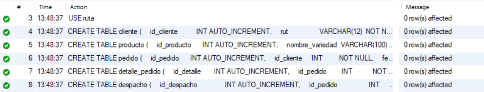
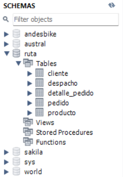
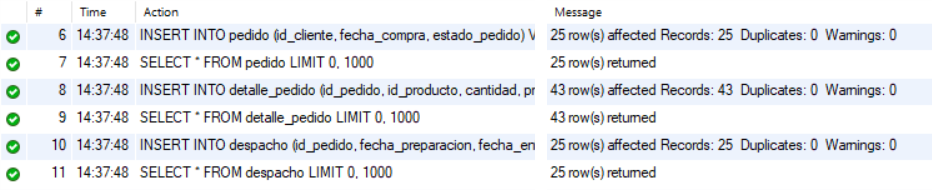
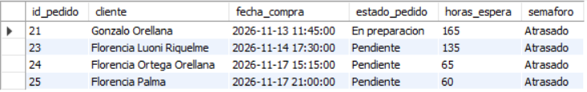
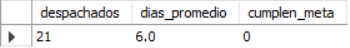
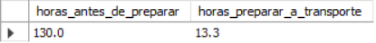
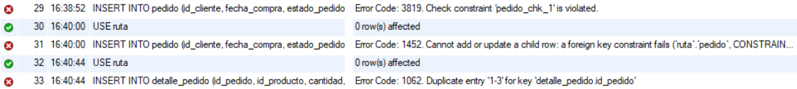

# 04 · SQL: base de datos, consultas y resultados

Corresponde a la **sección 6 del informe E2**. La base se hizo en SQL con MySQL Workbench.

## Archivos (`entrega-2/db/`)

Se ejecutan en este orden:

| Orden | Archivo | Qué hace |
|---|---|---|
| 1 | [`schema.sql`](../db/schema.sql) | Crea la base `ruta` con 5 tablas: cliente, producto, pedido, detalle_pedido y despacho (PK, FK, UNIQUE y CHECK) |
| 2 | [`seed.sql`](../db/seed.sql) | Carga los datos de prueba: 3 productos, 20 clientes, 25 pedidos, 43 líneas de detalle y 25 despachos |
| 3 | [`consultas.sql`](../db/consultas.sql) | Consultas de negocio. **Las consultas 1, 2 y 3 son las que se presentan en el informe** |
| 4 | [`pruebas_integridad.sql`](../db/pruebas_integridad.sql) | Tres datos incorrectos que la base tiene que rechazar |

El orden de ejecución y los resultados esperados también están en [`db/LEEME.md`](../db/LEEME.md).

Para que los resultados siempre den lo mismo, las consultas toman como "hoy" el **20-11-2026 a las 09:00**, que es cuando se cortaron los datos. En el uso real se cambia por `NOW()`.

## Creación de la base y carga de datos

*Figura 4. Ejecución de schema.sql.*

*Figura 5. Tablas creadas en la base ruta.*

Los datos de prueba se armaron a partir de lo que nos contó el dueño en la E1. Los clientes son inventados, y los pedidos van del 4 de septiembre al 17 de noviembre de 2026. Los pedidos despachados salen al transporte entre 4,7 y 7,3 días después de la compra (6,0 en promedio). El precio de cada línea queda guardado con el valor del día de la compra: 2.790 en septiembre y 2.990 desde octubre.

*Figura 6. Carga de seed.sql: 25 pedidos, 43 líneas de detalle y 25 despachos.*

## Consultas del informe

### Consulta 1 · ¿Qué pedidos están esperando y cuánto llevan? (RF-03 y RF-04)

*Figura 7.*

Hay 4 pedidos sin despachar y los 4 ya pasaron las 48 horas de la meta. El pedido 21 lleva 165 horas (casi 7 días) y sigue en preparación. Esta es la misma regla que usa la alerta de n8n.

### Consulta 2 · ¿Cuánto demora un pedido web en llegar al transporte? (KPI)

*Figura 8.*

Los pedidos demoran en promedio **6,0 días** y ninguno de los 21 despachados cumple la meta de 2 días. Esta es la línea base del KPI de la E1.

### Consulta 3 · ¿En qué parte del proceso se pierde el tiempo?

*Figura 9.*

Un pedido espera en promedio **130 horas** antes de que alguien empiece a prepararlo, contra **13 horas** desde que se prepara hasta que sale al transporte. El problema es que el pedido queda olvidado, no la preparación.

## Pruebas de integridad

| Prueba | Qué se intentó | Resultado |
|---|---|---|
| 1 | Guardar un pedido con estado 'Entregado' | Error 3819 (CHECK de estado) |
| 2 | Guardar un pedido de un cliente que no existe (id 99) | Error 1452 (clave foránea) |
| 3 | Agregar otra vez Merkén Ahumado al pedido 1 | Error 1062 (UNIQUE id_pedido, id_producto) |

*Figura 10. Las tres pruebas rechazadas por la base.*
